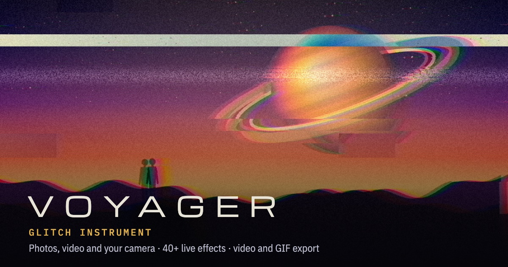

# VOYAGER

**A glitch instrument for photos, video and your camera.** Stack live effects, steer them by dragging on the image, paint where they show, and export stills, looping video or GIFs. It runs entirely in your browser: nothing is uploaded.

**Try it: [voyager-glitch.vercel.app](https://voyager-glitch.vercel.app)**



## What it does

- **40+ effects** in six groups: Digital (glitch, datamosh, pixel sort, JPEG, databend…), Analog (VHS, CRT, tape, night vision…), Color, Shape, 3D (wire grid, point cloud, extruded surface) and Type (ASCII, emoji, text, image overlays).
- **Layers** with blend modes, opacity, and painted masks so an effect only shows where you brush it.
- **Sources:** a photo, a video file, or your camera, live. Take a photo from the camera to keep working on it.
- **Steer:** drag on the image to aim and push the selected effect.
- **Motion:** live layers move on one shared clock, so exports loop without a jump.
- **Chaos** builds a random stack. Lock the layers you like and Chaos keeps them. **Randomize** rerolls one layer.
- **Export** a full resolution PNG or JPG, an MP4 or WebM recording, or a seamless GIF.
- **Share** a link that carries your stack, so anyone can try it on their own photo.
- **Autosave:** your photo or video, layers, masks and placed images survive a reload.
- Works on phones: touch steering, two-finger zoom, and saving straight to Photos.

## Keys

| Key | Action |
| --- | --- |
| Space | Freeze or play |
| O / V / P | Open a file / camera / place an image on top |
| A | Add an effect |
| R / Shift R | Chaos / randomize the selected layer |
| L | Lock the selected layer, or pin a placed image so zooming and dragging cannot move it |
| T / B / X | Steer / paint / erase |
| \ (hold) | Show the original |
| + / − / 0, Esc | Zoom in / out / fit. Ctrl or Cmd + scroll and pinch also zoom |
| S / E | Share link / export |
| Delete | Remove the selected layer or image |
| Ctrl/Cmd Z, Shift Ctrl/Cmd Z | Undo, redo |

## Running it

It's one static file with no build step. Open `index.html` through any local web server, for example:

```bash
python3 -m http.server 5173
```

Then visit http://localhost:5173. The camera needs `localhost` or https. VOYAGER needs WebGL2, which every current desktop and mobile browser supports.

## License

[MIT](LICENSE)
